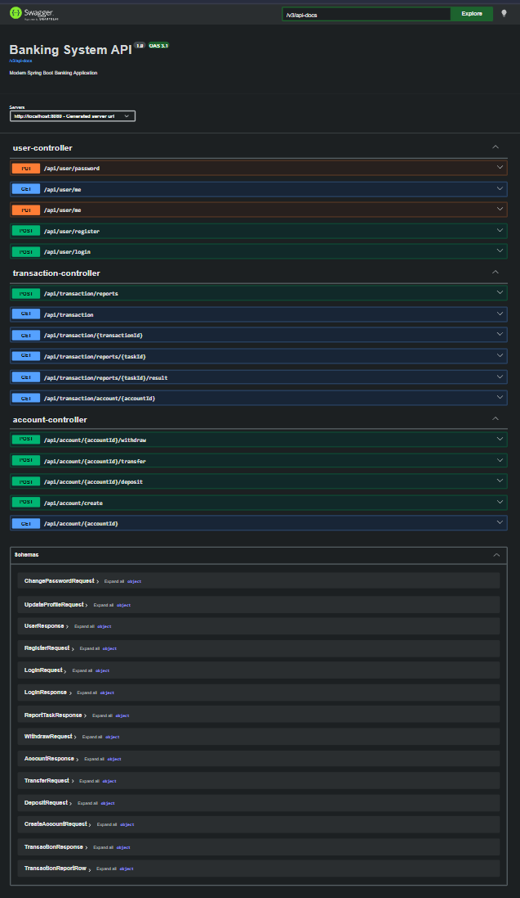
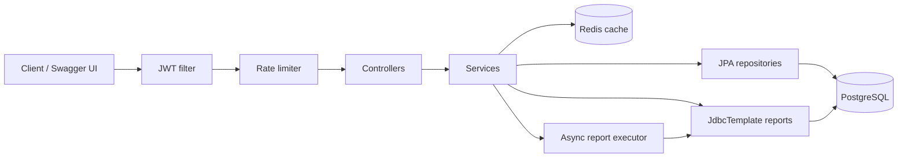
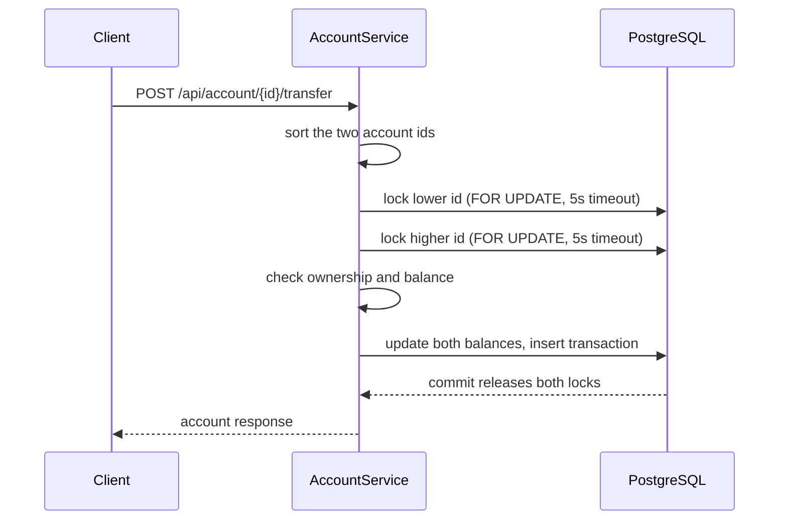
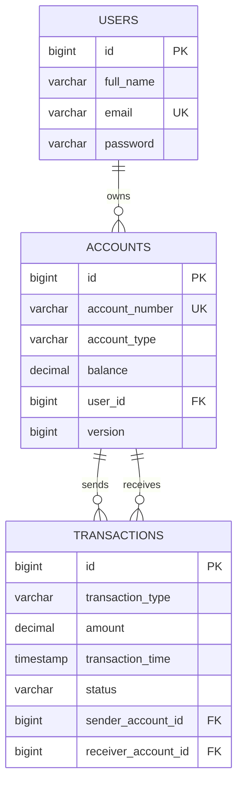

# Banking System — Spring Boot REST API

A secure banking backend built with **Java, Spring Boot, PostgreSQL and Redis**. It provides JWT authentication, bank accounts, deposits, withdrawals, transfers, transaction history, asynchronous reports, caching, rate limiting and Swagger documentation.

The focus of the project is **moving money safely under concurrent requests**: every balance change runs in a database transaction behind a pessimistic row lock, and transfers lock both accounts in a fixed order so opposite transfers cannot deadlock.



## Highlights

- **JWT security:** stateless Spring Security, BCrypt hashing, a custom JWT filter, and ownership checks so users only see their own accounts and transactions.
- **Concurrency-safe balances:** `SELECT ... FOR UPDATE` (`PESSIMISTIC_WRITE`) with a 5-second lock timeout for deposits, withdrawals and transfers.
- **Deadlock prevention:** transfers lock the lower account id first, then the higher one.
- **Redis caching:** reads are cached per user and evicted after money movement and profile changes.
- **Async reports:** a report request returns a task id; a dedicated thread pool (core 3, max 6, queue 50) builds the report with `JdbcTemplate` SQL joins.
- **Rate limiting:** Bucket4j token buckets per user (or IP when unauthenticated), for example 5 registrations/min, 10 logins/min, 20 money operations/min.
- **Database discipline:** Flyway migrations plus `CHECK` constraints (balance ≥ 0, amount > 0, valid types and statuses) as a second line of defense.
- **Quality:** 60+ tests (JUnit 5, Mockito, `@WebMvcTest`, Spring Security Test), centralized exception handling with typed domain exceptions, Swagger/OpenAPI and Actuator health endpoints.

## Architecture



Controllers handle HTTP and validation, services own the business rules and transaction boundaries, JPA handles writes, and `JdbcTemplate` handles read-only reporting SQL. DTOs are used as API contracts, so entities are never exposed directly.

## How a transfer stays safe

Two simultaneous requests that read the same balance can both pass the balance check. Locking the row before checking and updating prevents that. Transfers touch two rows, so locking order matters: if A→B and B→A each lock their source first, they wait on each other forever. Sorting the ids first removes that cycle.



A lock timeout returns a clean API error instead of hanging the request. More detail: [`Docs/Banking-System-Architecture-Deep-Dive.md`](Docs/Banking-System-Architecture-Deep-Dive.md) and [`Docs/banking-system-data-flow.md`](Docs/banking-system-data-flow.md).

## Caching

Reads of the user profile, accounts and transactions are cached in Redis. Keys include the authenticated user's email, so one user can never receive another user's cached data. Deposits, withdrawals and transfers evict the account and transaction caches, and profile updates evict the user cache.

## Data model



Account types are `SAVINGS` and `CURRENT`. Transaction types are `DEPOSIT`, `WITHDRAW` and `TRANSFER`; statuses are `PENDING`, `SUCCESS` and `FAILED`. Flyway migrations `V1`–`V3` create the schema.

## Tech stack

| Area | Tools |
|---|---|
| Language / framework | Java 17+ (virtual threads when run on JDK 21), Spring Boot 3.5 |
| Security | Spring Security, JWT, BCrypt |
| Persistence | Spring Data JPA / Hibernate, JdbcTemplate, PostgreSQL 16, Flyway |
| Caching / limits | Spring Cache + Redis 7, Bucket4j + Caffeine |
| Docs / ops | springdoc-openapi (Swagger UI), Spring Boot Actuator, Docker Compose |
| Testing | JUnit 5, Mockito, Spring Security Test |
| Build | Maven (wrapper included) |

## Run locally

Requirements: JDK 17+ and Docker.

```bash
# 1. Start PostgreSQL (host port 5332) and Redis (host port 6379)
docker compose up -d

# 2. Configure: copy .env.example and set values (never commit real secrets)
#    DB_URL, DB_USERNAME, DB_PASSWORD, JWT_SECRET, REDIS_HOST, REDIS_PORT

# 3. Run the API (Flyway creates the schema on startup)
./mvnw spring-boot:run        # Windows: mvnw.cmd spring-boot:run

# 4. Run the tests
./mvnw test
```

- Swagger UI: http://localhost:8080/swagger-ui.html
- OpenAPI JSON: http://localhost:8080/v3/api-docs
- Health: http://localhost:8080/actuator/health

## API overview

| Method | Endpoint | Purpose |
|---|---|---|
| POST | `/api/user/register` | Register |
| POST | `/api/user/login` | Log in, returns a JWT |
| GET / PUT | `/api/user/me` | View / update profile |
| PUT | `/api/user/password` | Change password |
| POST | `/api/account/create` | Create a SAVINGS or CURRENT account |
| GET | `/api/account/{id}` | Account details |
| POST | `/api/account/{id}/deposit` | Deposit |
| POST | `/api/account/{id}/withdraw` | Withdraw |
| POST | `/api/account/{id}/transfer` | Transfer to another account |
| GET | `/api/transaction` | Transaction history |
| GET | `/api/transaction/{id}` | One transaction |
| GET | `/api/transaction/account/{accountId}` | Transactions for an account |
| POST | `/api/transaction/reports` | Start an async report (returns a task id) |
| GET | `/api/transaction/reports/{taskId}` | Report status |
| GET | `/api/transaction/reports/{taskId}/result` | Report rows when finished |

Every endpoint except register and login needs `Authorization: Bearer <JWT>`.

### Quick example

```bash
# Register and log in
curl -X POST http://localhost:8080/api/user/register \
  -H "Content-Type: application/json" \
  -d '{"fullName":"Mohammed Zeeshan","email":"zeeshan@example.com","password":"Password123"}'

curl -X POST http://localhost:8080/api/user/login \
  -H "Content-Type: application/json" \
  -d '{"email":"zeeshan@example.com","password":"Password123"}'
# -> {"token":"<JWT>", "tokenType":"Bearer", ...}

# Create an account, deposit, then transfer
curl -X POST http://localhost:8080/api/account/create \
  -H "Authorization: Bearer <JWT>" -H "Content-Type: application/json" \
  -d '{"accountType":"SAVINGS"}'

curl -X POST http://localhost:8080/api/account/1/deposit \
  -H "Authorization: Bearer <JWT>" -H "Content-Type: application/json" \
  -d '{"amount":5000}'

curl -X POST http://localhost:8080/api/account/1/transfer \
  -H "Authorization: Bearer <JWT>" -H "Content-Type: application/json" \
  -d '{"receiveAccountId":2,"amount":1500}'
```

## Testing

61 tests cover the JWT service, JWT filter and security configuration, user/account/transaction services, and the controllers (`@WebMvcTest`), including validation and error handling.

```bash
./mvnw test
```

## Deployment

The repository includes a `Dockerfile`, `docker-compose.yml` and `.env.example`; see [`Docs/DEPLOYMENT.md`](Docs/DEPLOYMENT.md). Provide secrets through environment variables, not the repository.

## Known limitations

- Report task state and rate-limit buckets are in memory, so they reset on restart and are not shared between instances.
- Cache eviction clears whole caches after any money movement. It is simple and safe, but not the most efficient.
- There is no multi-threaded transfer test against a real PostgreSQL yet (Testcontainers is the next step).
- Password reset, refresh tokens and admin roles are not implemented.

## Next steps

Testcontainers concurrency tests · Redis-backed report tasks and distributed rate limiting · refresh tokens · idempotency keys for money operations · transaction pagination · CI pipeline

## License

Apache License 2.0 — see [`LICENSE`](LICENSE).

## Author

**Mohammed Zeeshan** — [GitHub](https://github.com/zeeshanverse) · [LinkedIn](https://www.linkedin.com/in/zeeshanmohd/)