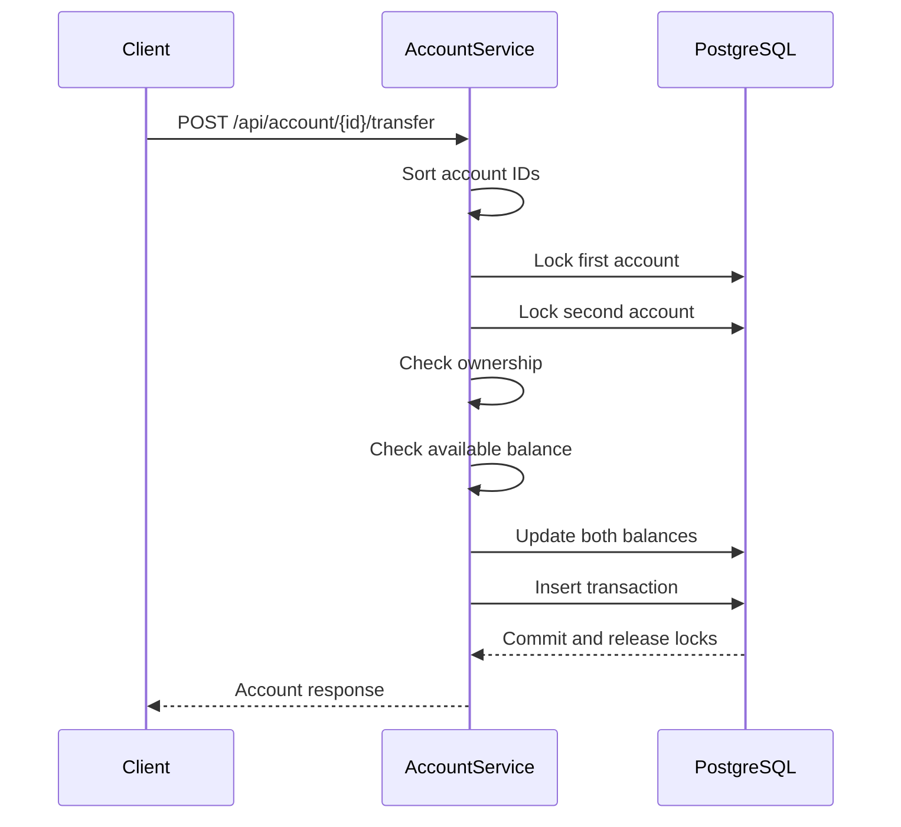
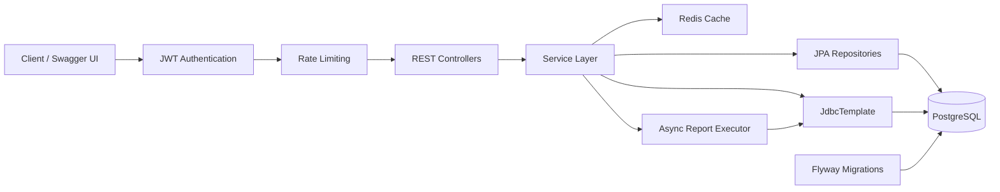
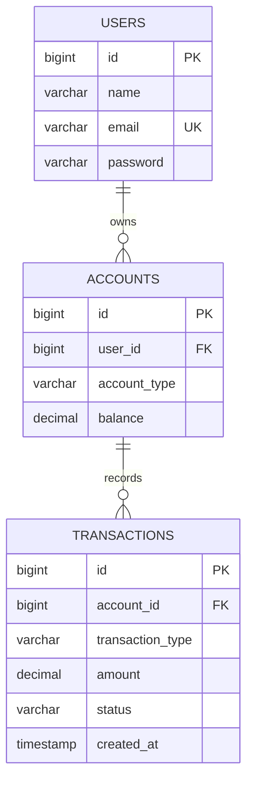

# Banking System — Spring Boot REST API

A secure banking backend built with **Java, Spring Boot, PostgreSQL, and Redis**. The application provides JWT-based authentication, account management, deposits, withdrawals, money transfers, transaction history, asynchronous reporting, caching, rate limiting, and API documentation.

The main focus of the project is handling **money movement safely under concurrent requests**. Deposits, withdrawals, and transfers run inside database transactions, while account balances are protected using pessimistic row locking. Transfers acquire account locks in a consistent order so that simultaneous transfers in opposite directions do not create a deadlock.


---

## Overview

This project implements the backend of a small banking system as a REST API.

A user can register and authenticate, create bank accounts, deposit or withdraw money, transfer funds between accounts, and view transaction history. Transaction reports can also be generated asynchronously instead of keeping the HTTP request open while a report is being processed.

The application uses a layered Spring Boot architecture:

```text
Client / Swagger UI
        │
        ▼
Spring Security + JWT
        │
        ▼
Rate Limiting
        │
        ▼
REST Controllers
        │
        ▼
Service Layer
        │
   ┌────┼───────────────┐
   ▼    ▼               ▼
 JPA  JdbcTemplate    Redis
   │    │               │
   └────┴───────┬───────┘
                ▼
           PostgreSQL
```

The important part of the system is not the account CRUD itself, but the way the application handles **security, transactional consistency, concurrent balance updates, reporting, and infrastructure concerns around the API**.

---

## Core Features

### Authentication and Authorization

- User registration and login using JWT.
- Stateless authentication with Spring Security.
- BCrypt password hashing.
- JWT validation through a custom authentication filter.
- Ownership checks prevent users from accessing accounts or transactions belonging to another user.
- Bean Validation for incoming request data.
- Centralized exception handling through `@RestControllerAdvice`.
- Domain-specific exceptions for cases such as insufficient balance, unauthorized access, and lock timeouts.

### Account Management

Users can create and access:

- `SAVINGS` accounts
- `CURRENT` accounts

Account operations are protected by authentication and ownership checks.

### Money Movement

The API supports:

- Deposits
- Withdrawals
- Account-to-account transfers

Money-changing operations execute inside database transactions.

A transfer updates both account balances and records the corresponding transaction as part of the same transactional operation.

### Transaction History

The application stores transaction information for money movement and exposes APIs for:

- All accessible transactions
- Individual transactions
- Transactions belonging to a specific account

### Asynchronous Reports

Transaction reports are handled separately from normal request processing.

A report request creates a task and returns a task ID. The report is processed using a dedicated `ThreadPoolTaskExecutor`, after which the client can check the task status and retrieve the result.

The configured executor uses:

```text
Core threads : 3
Maximum      : 6
Queue size   : 50
```

### Redis Caching

Redis is used as the backing store for Spring Cache.

Caching is applied to selected read-heavy operations such as:

- User/profile reads
- Account reads
- Transaction reads

Cache entries are invalidated when relevant data changes so that operations such as deposits, withdrawals, and transfers do not leave stale account information in the cache.

### Rate Limiting

The API uses **Bucket4j** for endpoint-level rate limiting.

Buckets are associated with the authenticated user where available and use the caller IP for unauthenticated requests.

Example limits include:

| Operation | Limit |
|---|---:|
| Registration | 5 requests/minute |
| Login | 10 requests/minute |
| Deposit | 20 requests/minute |
| Withdrawal | 20 requests/minute |
| Transfer | 20 requests/minute |

The bucket registry itself is maintained using Caffeine, so the current implementation is local to each application instance.

### Database Migrations

Flyway manages the database schema instead of relying on Hibernate to create the schema automatically.

Current migrations:

```text
V1 — Users
V2 — Accounts
V3 — Transactions
```

### API Documentation

The application uses SpringDoc OpenAPI and Swagger UI.

The generated OpenAPI specification exposes the REST endpoints, request models, response models, and error responses.

---

## Concurrency and Transaction Safety

Handling concurrent balance updates is one of the main technical aspects of this project.

A simple read-modify-write approach can produce incorrect balances when two requests operate on the same account at the same time.

For example:

```text
Initial balance = ₹10,000

Request A reads ₹10,000
Request B reads ₹10,000

Request A withdraws ₹7,000
Request B withdraws ₹6,000

Both requests could incorrectly pass the balance check
if the row is not protected.
```

To avoid this, the application uses pessimistic row locking.

```text
PESSIMISTIC_WRITE
        │
        ▼
SELECT ... FOR UPDATE
```

The account row is locked before the balance is checked and modified.

A five-second lock timeout is configured so a request does not wait indefinitely for a locked account.

---

## Transfer Locking and Deadlock Prevention

Transfers involve two accounts, which introduces another problem: deadlocks.

Consider two simultaneous requests:

```text
Transaction A:
Account 1 → Account 2

Transaction B:
Account 2 → Account 1
```

If each transaction locks its source account first:

```text
Transaction A → locks Account 1 → waits for Account 2

Transaction B → locks Account 2 → waits for Account 1
```

Both transactions are now waiting for each other.

The application avoids this by sorting the account IDs before acquiring locks.

For both transfers:

```text
Account 1 → Account 2
```

the lock order is always:

```text
smaller ID
    ↓
larger ID
```

So:

```text
1 → 2
2 → 1
```

both acquire the locks in the same order:

```text
1 → 2
```

This removes the circular wait condition that causes the classic opposite-transfer deadlock.

### Transfer Flow



The same locking approach is used for deposits and withdrawals, where only the affected account row needs to be locked.

---

## Architecture

The application follows a conventional layered Spring Boot architecture with separate responsibilities for controllers, services, persistence, security, and infrastructure.



### Controller Layer

Controllers act as the HTTP boundary of the application.

They handle:

- Request mapping
- Request validation
- DTO input/output
- HTTP responses

Business logic is kept in the service layer rather than being placed directly inside controllers.

### Service Layer

The service layer contains the main application rules:

- Authentication
- Ownership checks
- Account operations
- Balance validation
- Money movement
- Transaction creation
- Cache invalidation
- Transaction boundaries
- Report processing

Money-changing operations use `@Transactional` to maintain database consistency.

### Repository Layer

Spring Data JPA repositories handle normal persistence operations.

The account repository contains custom locking queries used when an account needs to be modified safely during concurrent requests.

### JDBC Reporting

`JdbcTemplate` is used separately for transaction reporting.

This allows reporting queries to use explicit SQL and joins without forcing the reporting layer through the entity model.

### Security Layer

The security flow is built around:

```text
Request
   │
   ▼
JWT Authentication Filter
   │
   ▼
SecurityContext
   │
   ▼
Controller
   │
   ▼
Ownership checks in Service
```

This keeps authentication and business-level authorization as separate concerns.

---

## Database Design

The main domain entities are:

```text
User
 │
 └───< Account
          │
          └───< Transaction
```

A user can own multiple accounts.

Transactions reference the account involved in the operation and contain information such as the transaction type, amount, status, and timestamp.

### Entity Relationship Diagram



Flyway owns the schema lifecycle through versioned migrations:

```text
V1__create_users_table.sql
V2__create_accounts_table.sql
V3__create_transactions_table.sql
```

---

## Technology Stack

| Category | Technology |
|---|---|
| Language | Java 17+ |
| Framework | Spring Boot 3.5 |
| Security | Spring Security, JWT, BCrypt |
| Persistence | Spring Data JPA, Hibernate |
| SQL / Reporting | JdbcTemplate |
| Database | PostgreSQL 16 |
| Database Migration | Flyway |
| Cache | Spring Cache, Redis 7 |
| Rate Limiting | Bucket4j, Caffeine |
| Async Processing | ThreadPoolTaskExecutor |
| API Documentation | SpringDoc OpenAPI / Swagger UI |
| Monitoring | Spring Boot Actuator |
| Testing | JUnit 5, Mockito, Spring Security Test |
| Containers | Docker Compose |
| Build | Maven Wrapper |

Java 17 is the project baseline. Virtual threads are enabled through Spring Boot and can be used when running the application on JDK 21+.

---

## Project Structure

```text
Banking-System/
│
├── src/
│   ├── main/
│   │   ├── java/com/banking/
│   │   │
│   │   └── resources/
│   │       ├── db/migration/
│   │       │   ├── V1__create_users_table.sql
│   │       │   ├── V2__create_accounts_table.sql
│   │       │   └── V3__create_transactions_table.sql
│   │       │
│   │       ├── application.properties
│   │       └── application-dev.properties
│   │
│   └── test/
│
├── Docs/
│   └── DEPLOYMENT.md
│
├── docs/
│   └── swagger.png
│
├── Dockerfile
├── docker-compose.yml
├── .dockerignore
├── .env.example
├── pom.xml
├── mvnw
├── mvnw.cmd
└── README.md
```

The Java source is organized around the following areas:

```text
com.banking/
├── config/
├── annotation/
│   └── ratelimit/
├── controller/
├── dto/
├── exception/
├── model/
├── repository/
├── security/
└── service/
    └── impl/
```

DTOs are used as API contracts instead of exposing persistence entities directly through the REST API.

---

## API Overview

### Authentication and User

| Method | Endpoint | Purpose |
|---|---|---|
| POST | `/api/user/register` | Register a new user |
| POST | `/api/user/login` | Authenticate and receive JWT |
| GET | `/api/user/me` | Get current user profile |
| PUT | `/api/user/me` | Update current user profile |
| PUT | `/api/user/password` | Change password |

### Accounts

| Method | Endpoint | Purpose |
|---|---|---|
| POST | `/api/account/create` | Create SAVINGS/CURRENT account |
| GET | `/api/account/{id}` | Get account details |
| POST | `/api/account/{id}/deposit` | Deposit money |
| POST | `/api/account/{id}/withdraw` | Withdraw money |
| POST | `/api/account/{id}/transfer` | Transfer money to another account |

### Transactions and Reports

| Method | Endpoint | Purpose |
|---|---|---|
| GET | `/api/transaction` | Transaction history |
| GET | `/api/transaction/{id}` | Get one transaction |
| GET | `/api/transaction/account/{accountId}` | Account transaction history |
| POST | `/api/transaction/reports` | Start asynchronous report |
| GET | `/api/transaction/reports/{taskId}` | Check report status |
| GET | `/api/transaction/reports/{taskId}/result` | Retrieve completed report |

Protected endpoints require:

```http
Authorization: Bearer <JWT>
```

Registration and login are the exceptions.

---

## API Examples

### Register

```bash
curl -X POST http://localhost:8080/api/user/register \
  -H "Content-Type: application/json" \
  -d '{
    "name": "Mohammed Zeeshan",
    "email": "zeeshan@example.com",
    "password": "Password123"
  }'
```

### Login

```bash
curl -X POST http://localhost:8080/api/user/login \
  -H "Content-Type: application/json" \
  -d '{
    "email": "zeeshan@example.com",
    "password": "Password123"
  }'
```

The login response returns a JWT.

Use that token for authenticated requests:

```bash
curl http://localhost:8080/api/user/me \
  -H "Authorization: Bearer <JWT>"
```

### Create Account

```bash
curl -X POST http://localhost:8080/api/account/create \
  -H "Authorization: Bearer <JWT>" \
  -H "Content-Type: application/json" \
  -d '{
    "type": "SAVINGS"
  }'
```

### Deposit

```bash
curl -X POST http://localhost:8080/api/account/1/deposit \
  -H "Authorization: Bearer <JWT>" \
  -H "Content-Type: application/json" \
  -d '{
    "amount": 5000
  }'
```

### Withdraw

```bash
curl -X POST http://localhost:8080/api/account/1/withdraw \
  -H "Authorization: Bearer <JWT>" \
  -H "Content-Type: application/json" \
  -d '{
    "amount": 1000
  }'
```

### Transfer

```bash
curl -X POST http://localhost:8080/api/account/1/transfer \
  -H "Authorization: Bearer <JWT>" \
  -H "Content-Type: application/json" \
  -d '{
    "toAccountId": 2,
    "amount": 1500
  }'
```

---

## Running Locally

### Requirements

- JDK 17+
- Docker Desktop
- Git
- Maven Wrapper is included, so a separate Maven installation is not required.

### 1. Start PostgreSQL and Redis

```bash
docker compose up -d
```

The development environment uses:

```text
PostgreSQL 16 → host port 5332
Redis 7       → host port 6379
```

Spring Boot's Docker Compose support can also detect the services during development.

### 2. Configure environment variables

Use `.env.example` as the reference for required configuration.

Do not commit real database passwords, JWT signing keys, or other credentials.

### 3. Start the application

Linux/macOS:

```bash
./mvnw spring-boot:run
```

Windows:

```powershell
.\mvnw.cmd spring-boot:run
```

Flyway applies the database migrations during application startup.

### 4. Run tests

Linux/macOS:

```bash
./mvnw test
```

Windows:

```powershell
.\mvnw.cmd test
```

---

## Swagger and OpenAPI

Swagger UI:

```text
http://localhost:8080/swagger-ui.html
```

OpenAPI specification:

```text
http://localhost:8080/v3/api-docs
```

The API documentation can be used to inspect the available endpoints, request models, responses, and security requirements.

---

## Testing

The project contains **60+ tests** covering the main application and security paths.

The test suite uses:

- JUnit 5
- Mockito
- Spring Security Test
- Spring Boot testing support
- `@WebMvcTest` for controller-level testing

Testing covers areas including:

- User registration and authentication
- JWT service
- JWT authentication filter
- Security configuration
- User/profile operations
- Account operations
- Deposits
- Withdrawals
- Transfers
- Transaction APIs
- Validation
- Exception handling

Run the full test suite with:

```bash
./mvnw test
```

---

## Design Decisions

### Pessimistic Locking

Pessimistic locking is used for money-changing operations because the account balance is shared mutable state.

Locking the row before checking and updating the balance prevents concurrent requests from modifying the same account based on stale data.

### Deterministic Lock Ordering

Transfers involve two account rows.

Locking those rows in a deterministic order prevents opposite transfers from forming a circular wait.

### JPA for Application Writes

Spring Data JPA and Hibernate handle the application's normal entity persistence and transactional writes.

### JdbcTemplate for Reporting

Reporting queries use `JdbcTemplate` because explicit SQL and joins are useful for read-oriented reporting without adding unnecessary complexity to the entity model.

### Dedicated Report Executor

Report generation is separated from normal request processing through a dedicated executor so that longer-running report tasks do not consume the normal request-processing resources.

### Redis for Read Caching

Frequently accessed read operations can benefit from caching, while cache invalidation is performed after relevant write operations.

---

## Operations and Monitoring

Spring Boot Actuator provides operational endpoints such as:

```text
/actuator/health
/actuator/info
```

The application can therefore expose basic health and application information separately from the business API.

Docker Compose provides the local PostgreSQL and Redis infrastructure required by the application.

---

## Deployment

The repository includes:

```text
Dockerfile
docker-compose.yml
.env.example
Docs/DEPLOYMENT.md
```

The deployment documentation contains the environment-specific configuration and deployment considerations.

For production deployments, secrets should be provided through environment variables or a secrets manager rather than committed to the repository.

The current in-memory report-task and rate-limit state also means that running multiple application instances requires additional infrastructure or a shared state implementation.

---

## Known Limitations

The project is a backend portfolio implementation rather than a complete production banking platform.

Current limitations include:

- Report task state is stored in memory and is lost when the application restarts.
- Report tasks are not shared between multiple application instances.
- Rate-limit bucket state is local to the application instance.
- A real PostgreSQL concurrent-transfer integration test using Testcontainers has not yet been added.
- Password reset is not implemented.
- Refresh tokens are not implemented.
- Role-based administrative endpoints are not implemented.

These provide natural areas for further development.

---

## Possible Next Steps

Some extensions that could be added later:

- Redis/database-backed report task storage
- Distributed rate limiting
- Testcontainers-based concurrent transfer tests
- Refresh-token authentication
- Password reset flow
- Role-based administration
- Transaction pagination and filtering
- Idempotency keys for money-changing requests
- Structured audit logging
- Additional monitoring and metrics
- CI/CD pipeline
- Frontend client

---

## License

This project is licensed under the Apache License 2.0.

See [`LICENSE`](LICENSE) for the full license text.

---

## Author

**Mohammed Zeeshan**

- GitHub: [zeeshanverse](https://github.com/zeeshanverse)
- LinkedIn: [Mohammed Zeeshan](https://www.linkedin.com/in/zeeshanmohd/)